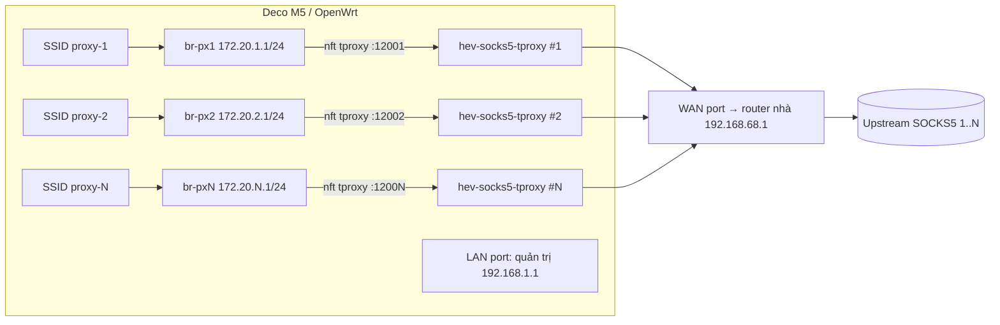

# Deco M5 → OpenWrt multi-SSID SOCKS5

## Brainstorm contract

- **Outcome:** Deco M5 chạy OpenWrt, phát N SSID; mọi traffic TCP (và UDP nếu proxy hỗ trợ) của client trên SSID *i* đi ra Internet qua upstream SOCKS5 *i*. DNS cũng đi qua proxy đó.
- **Constraints:**
  - Deco M5 không có trong bản OpenWrt chính thức → dùng bản community [dutchmillbytes/openwrt](https://github.com/dutchmillbytes/openwrt/releases) (các bản `v24.10.5-deco` … `v25.12.5-deco`, có image cho v1/v2/v3).
  - Flash 32 MB, overlay trống ~10 MB → không cài được `sing-box` (14,5 MB) hay `xray-core` (9,9 MB). Chỉ dùng package nhỏ.
  - Chỉ có 2 cổng Ethernet (WAN + LAN). Không có USB → không có extroot.
  - Flash bằng TFTP recovery: PC ở IP tĩnh `192.168.0.66`, file tên `M5v1_tp_recovery.bin`. Trên macOS việc này cần `sudo` (cổng 69 + đổi IP).
- **Non-goals:** mesh/roaming giữa nhiều Deco, quản lý proxy qua LuCI UI riêng, xoay vòng proxy hay failover, IPv6 qua proxy (sẽ tắt IPv6 trên các SSID proxy).
- **Acceptance criteria:**
  1. `ubus call system board` báo đúng model Deco M5, LuCI vào được.
  2. Client trên SSID *i* chạy `curl ifconfig.me` → ra đúng IP egress của proxy *i*, với mọi *i*.
  3. Test DNS leak: resolver nhìn thấy không phải ISP của WAN.
  4. Khi tắt proxy *i* → client SSID *i* mất mạng (fail-closed), **không** rơi về đường WAN thẳng.
  5. Reboot xong toàn bộ cấu hình vẫn chạy.

## Trạng thái hiện tại (đã kiểm tra trên máy Mac, 2026-10-25)

- Cổng USB-Ethernet `en5` (AX88179B) đang lên link 1000baseT, IP tĩnh `192.168.99.1/24`.
- **Chưa thấy Deco trên `en5`:** không có ARP/NDP neighbor, ping6 `ff02::1` không trả lời. Không bắt gói được vì `sudo` cần mật khẩu.
- Wi-Fi của Mac đang ở `192.168.68.0/24`, gateway `192.168.68.1` (MAC `14:eb:b6:…` = TP-Link). Đây gần như chắc chắn là một mạng Deco khác → cần xác nhận cục M5 này **không** còn là node trong mesh đó.

## Quyết định đã chốt với user (2026-10-25)

- Phần cứng: **M5 v3**, đã reset, không thuộc mesh nào.
- Firmware: user muốn bản **mới nhất**. Hỗ trợ Deco M5 đã được merge vào OpenWrt main (PR #17537, 2026-03-25), nên dùng **OpenWrt SNAPSHOT chính thức**: r37657, kernel 6.18.55. Image được build qua ASU, nhúng sẵn `luci`, `hev-socks5-tproxy 2.13.0`, `kmod-nft-tproxy` và `kmod-nft-socket` (xem `scripts/build-firmware.sh`). Nhờ vậy không còn rủi ro kmod lệch kernel. Bản fork `v25.12.5-deco` vẫn giữ trong `firmware/` làm phương án dự phòng.
- DNS: không chạy DNS forwarder trên router. DHCP phát resolver công cộng cho client, và query UDP/53 bị tproxy đi qua proxy giống mọi gói UDP khác. Port 53 của router đóng với các zone `pxN`, nên không có đường rò DNS.
- Số SSID: **hơn 8**. Proxy **có hỗ trợ UDP** → tproxy cả TCP lẫn UDP.
- User tự chạy các lệnh `sudo` (hoặc nhập mật khẩu khi được hỏi).

## Hướng tiếp cận (trade-offs)

| Cách | Package (kích thước) | TCP | UDP | DNS qua proxy | Phụ thuộc vào | Hỏng đầu tiên khi |
|---|---|---|---|---|---|---|
| **A. `hev-socks5-tproxy` + nft TPROXY (khuyến nghị)** | 53 KB, có trong feed chính thức | ✓ | ✓ (cần proxy hỗ trợ UDP ASSOCIATE) | ✓ (có DNS forwarder sẵn) | fw4/nft tproxy chạy ổn trên ipq40xx | proxy không hỗ trợ UDP → phải chặn UDP/QUIC |
| B. `redsocks` + nft redirect | 44 KB | ✓ | ✗ | ✗ (cần thêm dns2socks / ép DoT) | client chịu fallback sang TCP | app dùng UDP (QUIC, game, VoIP) |
| C. `sing-box`/`xray` | 10–15 MB | ✓ | ✓ | ✓ | đủ chỗ trống | **không vừa** overlay ~10 MB |

**Better approaches (vì cần >8 proxy):** QCA4019 (ath10k) chạy tối đa khoảng 8 VAP mỗi radio, nên 2 radio cho trần thực tế khoảng 16 SSID. Mỗi SSID phát beacon riêng, nên càng nhiều SSID càng tốn airtime, mạng càng chậm. Có hai cách để vượt ngưỡng này:
- **PPSK, một SSID nhiều mật khẩu:** hostapd `wpa_psk_file` kèm `vlanid=`. Mỗi mật khẩu được gán vào một VLAN, rồi ra bridge `pxN` và proxy N. Phần proxy giữ nguyên, chỉ khác lớp Wi-Fi. Không tốn thêm beacon, nên mở rộng lên vài chục proxy được. Đổi lại, client thấy cùng một tên Wi-Fi và chọn proxy bằng mật khẩu.
- **Lai:** khoảng 8 SSID đầu đặt tên riêng (4 ở 2.4 GHz, 4 ở 5 GHz, hoặc mỗi SSID phát cả hai băng). Phần còn lại dùng PPSK.
Khuyến nghị là bắt đầu bằng multi-SSID đúng như yêu cầu, đo thực tế với 8, 12 rồi 16 SSID. Thiết kế phần proxy theo `pxN` để sau này chuyển sang PPSK chỉ cần đổi file `wireless`.

## Kiến trúc (cách A)

- Mỗi SSID là một `wifi-iface` riêng → một network/bridge riêng → subnet và DHCP riêng → firewall zone riêng. Zone `pxN` **không** forward sang `wan` (fail-closed); chỉ cho vào router các cổng DHCP/DNS/tproxy.
- nft (file include của fw4): `iifname br-pxN meta l4proto {tcp,udp} ip daddr != {local, RFC1918} tproxy ip to :1200N meta mark set 0x1`, kèm `ip rule fwmark 0x1 lookup 100` và `local 0.0.0.0/0 dev lo table 100`.
- DNS: dnsmasq trả cho client SSID *i* DNS server là `172.20.i.1:53`, port này do hev instance *i* lắng nghe (hoặc DNAT tới) → hev forward DNS qua TCP qua proxy *i*.
- Mỗi instance hev-socks5-tproxy có file `/etc/hev-socks5-tproxy/pxN.yml` riêng (upstream host/port/user/pass, cổng tproxy, cổng DNS). Một init script procd khởi chạy N instance.
- Tắt IPv6 (RA/DHCPv6) trên các zone `pxN` để IPv6 không chạy vòng qua proxy.
- Giới hạn thực tế: ath10k trên IPQ4019 chạy ~4–8 VAP mỗi radio. Có thể bật mỗi SSID trên cả 2.4 và 5 GHz hoặc chia theo băng tần.

## Các phase

### Phase 0 — Chuẩn bị (không đụng thiết bị)
1. Đọc label dưới đáy Deco → model **M5 v1 / v2 / v3** (hoặc FCC ID: `TE7M5`=v1, `TE7M5V3`=v3). Image nào phải khớp đúng version đó.
2. Nếu M5 đang nằm trong mesh Deco của nhà → xoá nó khỏi app Deco rồi reset (giữ nút reset 10 giây). Forum có báo trường hợp node đang trong mesh không chịu kéo TFTP.
3. Tải về thư mục `firmware/`:
   - `openwrt-25.12.5-ipq40xx-generic-tplink_deco-m5-v3-squashfs-factory.bin` và `…-sysupgrade.bin` từ release `v25.12.5-deco`.
   - **Firmware stock** của TP-Link cho đúng version → dùng để quay về (cũng flash bằng TFTP recovery y như vậy).
   - Kiểm tra sha256 với release.
4. Chuẩn bị danh sách proxy: `host:port:user:pass` cho từng SSID, và hỏi bên cung cấp xem proxy có hỗ trợ UDP không.

### Phase 1 — Flash OpenWrt qua TFTP (cần sudo trên Mac)
1. `sudo networksetup -setmanual "AX88179B" 192.168.0.66 255.255.255.0`
2. `sudo mkdir -p /private/tftpboot && sudo cp factory.bin /private/tftpboot/M5v1_tp_recovery.bin` (thêm một bản tên chữ thường `m5v1_tp_recovery.bin`, vì log của một máy v3 cho thấy nó xin tên chữ thường).
3. `sudo launchctl load -F /System/Library/LaunchDaemons/tftp.plist`, rồi theo dõi bằng `sudo tcpdump -ni en5 port 69`.
4. Cắm cáp vào **cổng xa cổng nguồn nhất**. Rút nguồn, giữ reset, cắm nguồn, giữ tới khi thấy RRQ/transfer (≥10 giây) rồi thả. Chờ đèn đổi màu (~2–3 phút). Không rút điện trong lúc này.
5. Dừng tftpd: `sudo launchctl unload /System/Library/LaunchDaemons/tftp.plist`.
- **Rollback:** làm lại y hệt các bước trên với firmware stock (đổi tên thành `M5v1_tp_recovery.bin`).

### Phase 2 — Cấu hình nền
1. Mac `en5` → DHCP (hoặc `192.168.1.2/24`), vào `ssh root@192.168.1.1`, đặt mật khẩu root, chép SSH key cho Mac.
2. Xác minh: `ubus call system board`, `df -h /overlay` (mong ~10 MB), `cat /etc/board.json` để biết cổng nào là WAN, cổng nào là LAN.
3. Đổi IP LAN sang `192.168.1.254` (như wiki khuyến nghị) hoặc giữ nguyên. Cắm WAN vào router nhà, kiểm tra `ping 1.1.1.1` và `opkg update`/`apk update`.
4. Backup: `sysupgrade -b /tmp/base.tar.gz` → kéo về Mac.

### Phase 3 — Multi-SSID + proxy
1. Cài: `hev-socks5-tproxy`, `kmod-nft-tproxy`, `kmod-nft-socket` (nếu chưa có sẵn).
2. Script `scripts/provision.sh` (chạy trên Mac, đẩy qua SSH) sinh từ `proxies.csv`:
   - UCI `network` (bridge `pxN`, `172.20.N.1/24`), `wireless` (SSID/khoá cho từng mục), `dhcp` (pool, DNS=gateway, tắt RA), `firewall` (zone `pxN`, input chỉ cho DHCP/DNS, không forward).
   - `/etc/hev-socks5-tproxy/pxN.yml` + init script procd chạy nhiều instance.
   - `/etc/nftables.d/90-socks-tproxy.nft` + policy routing (`ip rule`/route table 100) qua hotplug/`network` rule.
   - Nếu proxy không hỗ trợ UDP: bỏ UDP khỏi tproxy, reject `udp` (QUIC 443) trên zone `pxN`, chỉ giữ DNS.
3. Giữ secret (user/pass proxy, key Wi-Fi) ở `proxies.csv` local và đưa vào `.gitignore`. Không commit file này.

### Phase 4 — Kiểm tra (đối chiếu acceptance criteria)
- Với mỗi SSID: điện thoại/laptop join → `curl ifconfig.me`, `curl -6 …` (phải fail), dnsleaktest.
- Dừng hev instance *i* → client *i* phải mất mạng, không ra được IP WAN thật.
- Reboot → lặp lại kiểm tra.
- Backup cấu hình cuối: `sysupgrade -b`.

## Rủi ro

- **kmod không khớp kernel (rủi ro lớn nhất):** bản community có kernel build riêng, nên `apk add kmod-nft-tproxy` từ feed chính thức có thể bị từ chối. Ở Phase 2, chạy `apk add kmod-nft-tproxy kmod-nft-socket` trước tiên. Nếu lỗi, có ba phương án: (a) xem image đã có sẵn module chưa (`lsmod | grep tproxy`), (b) tự build image từ source fork, bật sẵn các module này cùng `hev-socks5-tproxy`, (c) tạm dùng nft `redirect` cho TCP. Phương án (c) không cần kmod tproxy nhưng mất UDP.

- **Brick/không vào được TFTP:** đường quay về là TFTP recovery chính chủ của TP-Link; nếu cả nó cũng hỏng thì phải dùng UART (3.3 V, 115200, nằm dưới heatsink).
- **Chip flash v1/v2 (GD25Q256C):** có cảnh báo SFDP không nhận trên kernel 6.6 → bản v1/v2 rủi ro hơn v3.
- **Bản community:** không được OpenWrt chính thức bảo trì; update phải chờ fork phát hành.
- **Hiệu năng:** CPU 4×717 MHz Cortex-A7, tproxy userspace có thể giới hạn ở khoảng vài chục Mbps cho mỗi luồng. Mức này đủ cho proxy dân dụng, nhưng chưa đo.
- **Wi-Fi driver:** mỗi VAP thêm vào ăn thêm airtime và RAM; nên test 4 SSID trước rồi mới tăng lên.
